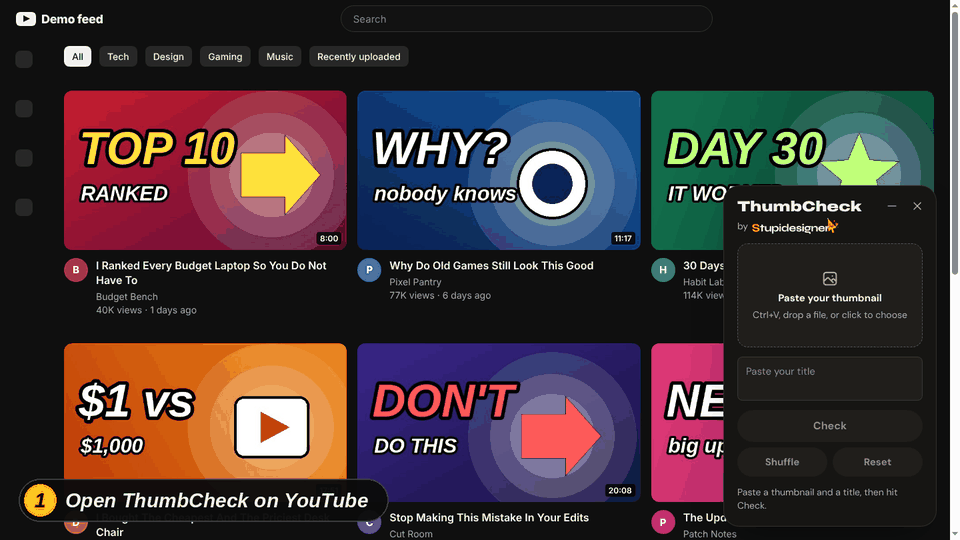
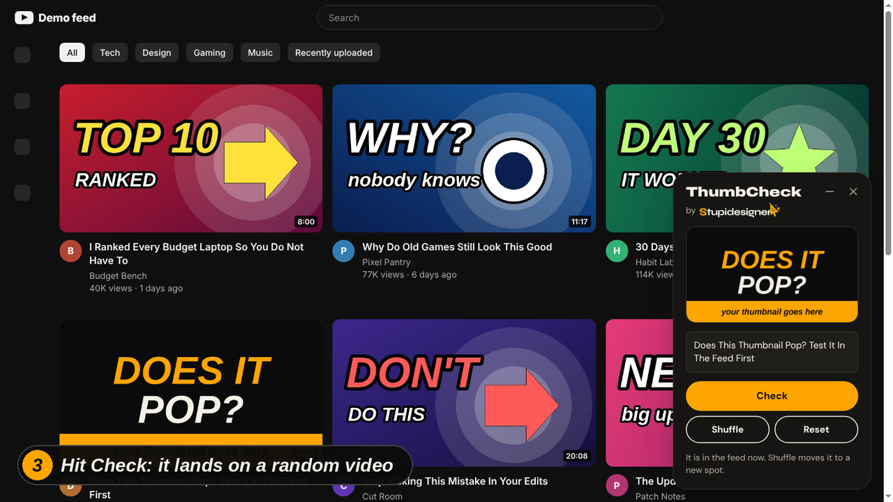

# ThumbCheck by Stupidesigner

**See your thumbnail and title on the real YouTube page before you upload.**



Paste a title. Paste a thumbnail. Hit **Check**. ThumbCheck swaps them onto a random video on the YouTube page you have open, so you see your work next to the real competition, at real size, before anyone else does.

Free. Open source. No sign-up. Nothing leaves your browser.

Made by [Stupidesigner](https://stupidesigner.com). Stupid Name, Smart Design.

> The demo above runs on a made-up feed, so no real channel ends up in this repo. On YouTube it swaps into the real page.

## What it does

- Works on the **Home** feed, on **Search** results and in the **Up next** list beside a video.
- **Check** puts your thumbnail and title on a random video you can see. **Shuffle** moves it. **Reset** puts the page back.
- Paste a new version while it is on the page and it updates **in the same spot**. Good for comparing A against B.
- It follows you from page to page until you hit Reset.
- Paste works anywhere on the page (⌘V on a Mac, Ctrl+V on Windows): text becomes the title, an image becomes the thumbnail. Drag and drop works too.
- Light and dark YouTube both work. The video length, channel name and view count on the card stay real, so only your thumbnail and title change.

## Install (Chrome, Brave, Edge, Arc)

It is not on the Chrome Web Store, so you load it by hand. It takes about two minutes.

1. Click the green **Code** button on this page, then **Download ZIP**. Unzip it.
2. Open `chrome://extensions` in your browser.
3. Turn on **Developer mode** (top right).
4. Click **Load unpacked** and pick the `extension` folder inside the folder you unzipped.
5. Click the puzzle icon in the toolbar and pin **ThumbCheck by Stupidesigner**. The icon is Mr. Oops, the yellow cursor.

Keep the folder where it is. The browser runs the extension from that folder.

## Use it

1. Open YouTube and click Mr. Oops in the toolbar. (Click him on any other site and he opens YouTube for you.)
2. Paste your title, then paste your thumbnail.
3. Hit **Check**.

A few extras:

- The minus button shrinks the panel to a small Mr. Oops button, so nothing covers the feed. The X hides it. The toolbar icon brings it back.
- Enter in the title box does the same as Check. Esc shrinks the panel.
- It picks from the videos you can see right now. Scroll down and hit Shuffle to try it lower in the feed.
- It remembers your last title and thumbnail.



## Privacy

- ThumbCheck only runs on `youtube.com`.
- Your thumbnail and title never leave your computer. There is no server, no analytics and no account.
- Your last title and thumbnail are kept in the browser's own extension storage, on your machine.
- The swap only changes what you see on your own screen. Reset or a page reload undoes it.

Permissions it asks for: `storage` (to remember your last title and thumbnail), `scripting` (to start on a YouTube tab that was already open) and access to `https://www.youtube.com/*`.

## Good to know

- YouTube changes its page layout from time to time. If that breaks ThumbCheck, open an issue and say which page.
- The swapped video cannot be clicked or hovered while your preview is on it.
- Safari and Firefox are not supported.

## For developers

Plain JavaScript, Manifest V3, no build step and no dependencies.

```
extension/
  manifest.json
  background.js   the toolbar button, and it hands the panel its fonts and pictures
  core.js         finds the video cards on the page and does the swap
  panel.js        the panel you paste into
tests/            end-to-end tests that drive the real extension in a real browser
```

Run the tests:

```
cd tests
npm install
npx playwright install chromium
npm test             # 53 checks on a stand-in page
npm run test:live    # 15 checks on the real youtube.com, signed out
```

More in [tests/README.md](tests/README.md).

## Licence

- Code: [MIT](LICENSE).
- Fonts: Archivo and DM Sans, under the SIL Open Font License 1.1. The licence files are in `extension/fonts`.
- The Stupidesigner name, the wordmark and Mr. Oops are **not** part of the MIT licence. See [BRAND.md](BRAND.md). If you fork this, put in your own name and pictures.

## Who made this

Stupidesigner is a design studio for YouTube creators: thumbnails, channel branding and short videos, with 2,000+ thumbnails designed so far. If your channel needs thumbnails that win the click, say hi at [stupidesigner.com](https://stupidesigner.com) or hello@stupidesigner.com.

If ThumbCheck saved you from a weak thumbnail, a star on this repo helps other creators find it.
